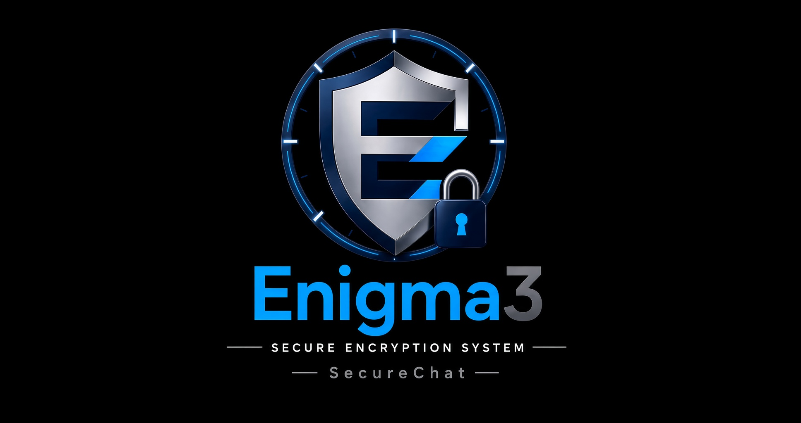

<div align="center">



<br/>

[](https://github.com/JImmyB0nes/SecureChat-App/releases/latest)
[](https://github.com/JImmyB0nes/SecureChat-App/releases)
[](#protection)
[](https://github.com/JImmyB0nes/SecureChat-App/releases/latest)
[](#downloads)

# Enigma 3

**Your messages. Your server. No one else.**

The client for a self-hosted SecureChat deployment: end-to-end encrypted
messages, calls and shared rooms — on your own hardware, not at a corporation.

<br/>

[**⬇ DOWNLOAD NOW**](https://github.com/JImmyB0nes/SecureChat-App/releases/latest)  [**🔐 Checksums**](https://github.com/JImmyB0nes/SecureChat-App/releases/latest)  [**📖 What's new**](https://github.com/JImmyB0nes/SecureChat-App/releases)

<br/>

[](#downloads)
[](#downloads)
[](#downloads)
[](#downloads)
[](#iphone)

</div>

---

<details>
<summary><b>📑 Contents</b> — click to expand</summary>

- [📦 Downloads](#downloads)
- [⚡ Get started in three steps](#get-started)
- [🛡️ What the app protects](#protection)
- [🔍 Verifying integrity](#integrity)
- [📱 iPhone and the web app](#iphone)
- [❓ Common cases](#cases)
- [💬 Contact](#contact)

</details>

---

<a id="downloads"></a>

## 📦 Downloads

Everything lives in the [latest release](https://github.com/JImmyB0nes/SecureChat-App/releases/latest). One click on your platform takes you to the file.

| Platform | File | Getting it running |
| :--- | :--- | :--- |
| 🪟 **Windows 10/11** (x64) | [`Enigma-3-Setup-<Version>.exe`](https://github.com/JImmyB0nes/SecureChat-App/releases/latest) | Run it. Replaces earlier versions, keeps all data. |
| 🐧 **Linux x86_64** | [`Enigma-3-<Version>-x86_64.AppImage`](https://github.com/JImmyB0nes/SecureChat-App/releases/latest) | `chmod +x` — then double-click. |
| 🐧 **Linux arm64** | [`Enigma-3-<Version>-arm64.AppImage`](https://github.com/JImmyB0nes/SecureChat-App/releases/latest) | `chmod +x` — then double-click. |
| 🤖 **Android 7+** | [`Enigma-3-<Version>.apk`](https://github.com/JImmyB0nes/SecureChat-App/releases/latest) | Signed release APK (`CN=Enigma 3`). |
| 🍎 **iPhone / iPad** | — | Through the web app of your server, no store distribution. |

**Always included:** `SHA256SUMS-<Version>.txt`, `update-manifest.json` and
`update-manifest.json.sig` — see [Verifying integrity](#integrity).

> **Recommendation:** Always update straight to the newest version.
> Older releases stay available for reference but are no longer recommended.

<details>
<summary><b>Why not through the Microsoft Store or Google Play?</b></summary>

Enigma 3 is distributed exclusively from this repository. A store route would
place a third point of trust between you and your server — and every update
would pass a provider's review. A store distribution also cannot treat a
self-hosted server address as an equal entry point.

</details>

---

<a id="get-started"></a>

## ⚡ Get started in three steps

<table>
<tr>
<td width="33%" align="center">

**1 · Server**
A running SecureChat deployment with HTTPS.

</td>
<td width="33%" align="center">

**2 · App**
Download it here and install it.

[Downloads](#downloads)

</td>
<td width="33%" align="center">

**3 · Start**
Enter the server address, sign in, go.

</td>
</tr>
</table>

On first launch you only enter `chat.example.com`. Everything else happens
encrypted on your device.

---

<a id="protection"></a>

## 🛡️ What the app protects

<table>
<tr>
<td width="50%">

### 🔒 End-to-end
Your device encrypts the message before it leaves the house.
The server relays and stores what it cannot read.

### 🔁 Forward secrecy
Every message has its own key. A lost key does not expose
your past.

</td>
<td width="50%">

### 📱 Device lock
Biometrics or an 8-digit PIN seal the keys in a local vault
(Argon2id with the device secret as pepper). Android uses the
keystore, Windows DPAPI.

### ⏳ Self-deletion
You decide how long your messages stay —
on the server and on every device.

</td>
</tr>
</table>

**No tracking. No crash reporting. No background downloads.**
Updates come exclusively from this repository.

---

<a id="integrity"></a>

## 🔍 Verifying integrity

```sh
sha256sum -c SHA256SUMS-<Version>.txt
```

**Automatic updates:** The desktop app checks every update against two
security levels:

1. An **Ed25519 signature** (`update-manifest.json` and `update-manifest.json.sig`
   in the release). The app has the sender key built in.
2. The **SHA-256 checksum** of every file.

Without a matching signature the app does not offer an update.

<details>
<summary><b>Recomputing the checksum by hand</b></summary>

```sh
# Windows (PowerShell)
Get-FileHash .\Enigma-3-Setup-<Version>.exe -Algorithm SHA256

# Linux / macOS
shasum -a 256 Enigma-3-<Version>-x86_64.AppImage
```

Compare the result with the line in `SHA256SUMS-<Version>.txt`.
If it differs, do not install the file and report it privately as described
in [SECURITY.md](SECURITY.md).

</details>

---

<a id="iphone"></a>

## 📱 iPhone and the web app

No iOS app is distributed through the App Store. Instead:

1. Open `https://chat.example.com` in **Safari**.
2. Use **Share › Add to Home Screen** to keep it as a full-screen page.
3. Use it like an app — sign-in, calls and notifications run through the
   web app of your server.

The feature set matches the web app; screen sharing and background
notifications are subject to the limits of iOS.

---

<a id="cases"></a>

## ❓ Common cases

<details>
<summary><b>Windows says "Windows protected your PC"</b></summary>

The installer is deliberately unsigned — a certificate would be one more
point of trust that can simply be bought. Confirm the warning only if this
page was the source, and check the SHA-256 checksum.

</details>

<details>
<summary><b>Android: "App not installed"</b></summary>

Uninstall an existing debug APK first — the release key is a different one.
Installation afterwards via "Unknown sources".

</details>

<details>
<summary><b>Updating without losing data</b></summary>

Simply install the new version over the existing one. All sessions,
settings and keys are preserved.

</details>

<details>
<summary><b>First launch after a major update</b></summary>

From version **1.7.24** the PIN is 8 digits and mandatory on desktop.
Existing vaults with the old PIN still unlock; please set the new length
next time.

</details>

---

<a id="contact"></a>

## 💬 Contact

| Topic | Route |
| :--- | :--- |
| Questions and bugs | [**GitHub Issues**](https://github.com/JImmyB0nes/SecureChat-App/issues) |
| Security issues | Privately, see [SECURITY.md](SECURITY.md) |
| Releases and changelog | [Latest release](https://github.com/JImmyB0nes/SecureChat-App/releases) |
